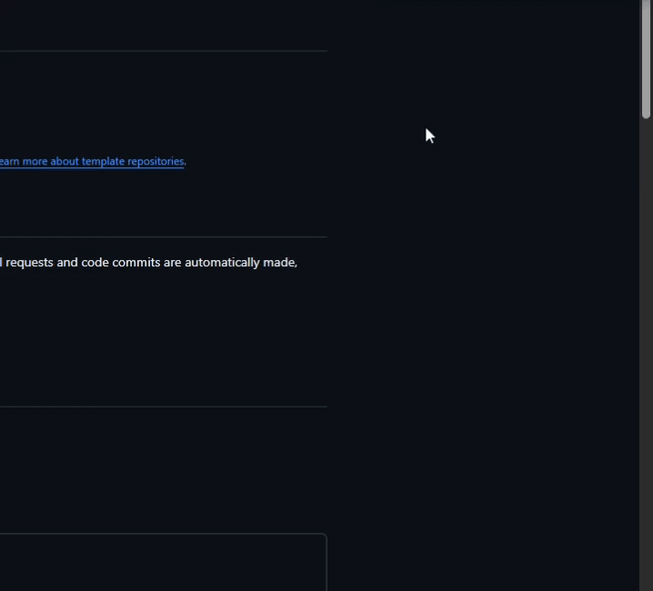

<p align="center">
  
</p>

# curmb

Standalone Windows 11 x64 cursor motion blur. No Windhawk or additional runtime
is required. Run **one** of these files:

| Executable | Source | Effect |
| --- | --- | --- |
| `curmb.exe` | `curmb.cpp` | Baseline: motion blur with the settings below. |
| `curmb_1.exe` | `curmb_1.cpp` | Baseline + an extra afterimage at the latest sampled cursor position while the real cursor is hidden. |
| `curmb_2.exe` | `curmb_2.cpp` | Same afterimage as `curmb_1.exe`, plus more frequent frame scheduling. |

In `_1` and `_2`, the extra afterimage uses the same cursor image and opacity as
the latest trail copy, not an opaque pointer. It fades with the trail and is not
drawn when there is no trail. Overlapping translucent copies can still make a
region appear brighter. It uses the latest sampled position, not a hardware
cursor; it cannot remove Windows compositor latency.

`curmb_2.exe` schedules frames approximately a quarter of a refresh period
apart, with a 2 ms minimum, measured from the start of a successful frame. It
may use more CPU and does not guarantee lower display latency.

All variants use the same single-instance lock; stop the running one before
trying another. Each launches a second instance of the same executable as a
watchdog. End the primary process in Task Manager to stop it. The watchdog
restores system cursors if the primary process is terminated while they are
hidden. If both are forcibly terminated together, launch a variant again to
restore any cursor scheme left hidden.

The values from `settings.txt` are compiled into all executables: opacity 45%,
minimum blur speed 50 cm/s, trail duration 20 ms, hide above 90 cm/s, and pause
for fullscreen applications. No settings file is needed at runtime.

The overlay is an ordinary topmost window; without injection or UIAccess it
cannot appear above protected Windows surfaces such as Start or the secure
desktop. Fullscreen detection uses Windows notification state. The variants
have not been visually tested or latency-measured on Windows.

## Build

The three `.cpp` files are independent: each contains the complete program and
has no project-local header dependencies. `build.sh` compiles each source into
its matching executable, without selecting variants through compiler defines.

Run `./build.sh` with Zig 0.14.0-dev.2456+a68119f8f in PATH (or set `ZIG` to
its path). Zig provides the Clang compiler, LLD linker, and MinGW Windows
headers and import libraries.

## Tests

On an x86-64 machine with Python 3 and a C++ compiler:

```sh
python3 tests/run.py
```

The script tests the actual portable kernel extracted from each source. The
blend test compares its entire destination buffer in 30,000 randomized cases
against the original scalar calculation. The trail test checks frame intervals,
head placement, opacity, fading, and buffer bounds. These tests do not exercise
Win32 cursor hiding or DWM presentation.